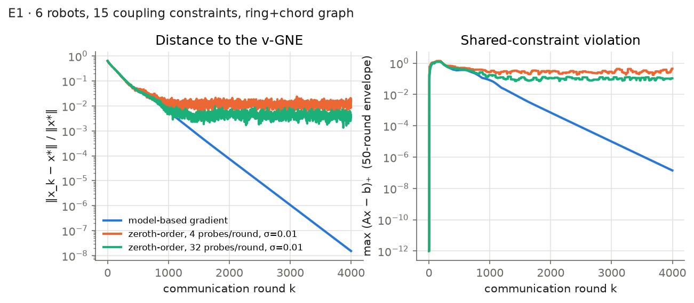
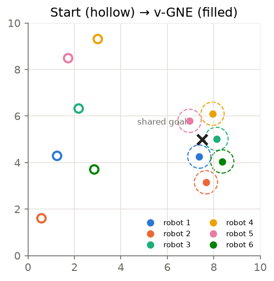
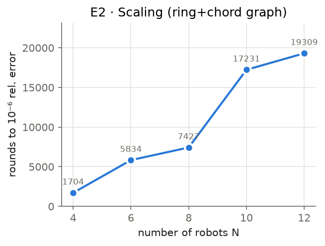
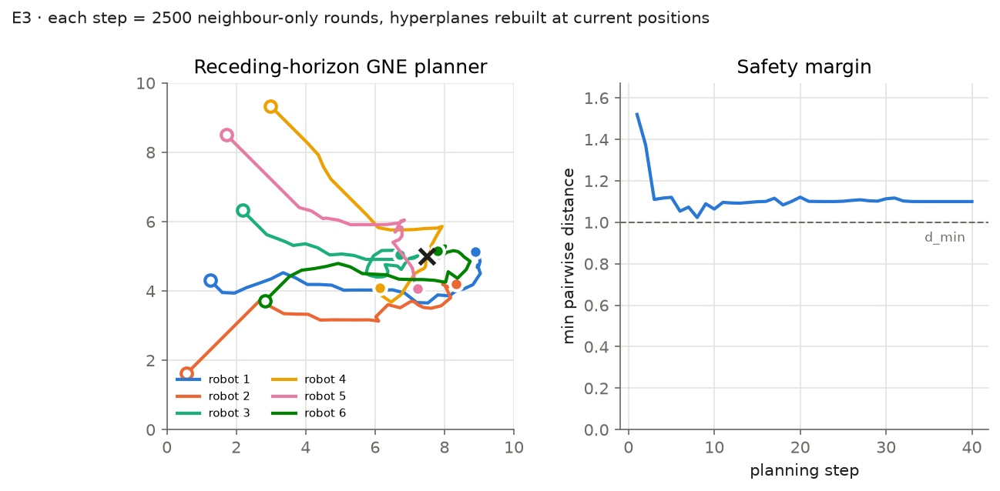

# gne-formation — distributed generalized Nash equilibrium seeking for multi-robot formations

A compact, tested Python implementation of **fully distributed GNE seeking under partial-decision information**, applied to selfish robots that compete for a shared goal while keeping a formation and respecting shared collision-avoidance constraints. It bridges my MSc work on safe, distributed formation control of multi-agent systems with monotone game theory and operator-splitting equilibrium seeking.

> **Status:** self-study implementation of established methods (Pavel, IEEE TAC 2020; Bianchi–Belgioioso–Grammatico, Automatica 2022; Krilašević–Grammatico, Automatica 2021) on a new benchmark. No novelty is claimed for the algorithms; the contribution is the formulation, the verification harness and the experiments.

## The game

Robot *i* picks a planar position $x_i\in\Omega_i\subset\mathbb R^2$ and minimises

$$J_i(x_i,x_{-i}) = \tfrac{a_i}{2}\lVert x_i-g\rVert^2 + \sum_{j\in\mathcal F_i}\tfrac{b_{ij}}{2}\lVert x_i-x_j-d_{ij}\rVert^2 ,$$

with every robot wanting the **same** goal $g$ (so they compete for it) and asymmetric formation weights $b_{ij}\neq b_{ji}$. The pseudo-gradient Jacobian is non-symmetric, so this is a genuine non-potential game, and it is strongly monotone (μ ≈ 0.87, L ≈ 3.9 for N = 6).

**Shared constraints.** Collision avoidance $\lVert x_i-x_j\rVert\ge d_{\min}$ is non-convex. Each pair gets a separating hyperplane instead, $n_{ij}^\top(x_j-x_i)\ge d_{\min}$ with $n_{ij}$ the unit vector between reference positions. It is a convex inner approximation (it implies the true constraint), and stacking gives $Ax\le b$ with $A=[A_1,\dots,A_N]$, which is the standard GNEP class. The target is the **variational GNE** (one shared multiplier λ, a "fair" price on every pairwise constraint).

## The algorithm (each agent, each round, neighbour-only communication)

Each agent keeps its decision, an **estimate of every other agent's decision**, a local copy $\lambda_i$ of the multiplier and an auxiliary $z_i$:

```
x_i     ← P_Ωi[ x_i − α(∇_i J_i(own estimates) + A_iᵀλ_i + c Σ_j w_ij (x_i − x̂_j,i)) ]
x̂_i,−i  ← x̂_i,−i − α c Σ_j w_ij (x̂_i,−i − x̂_j,−i)
z_i     ← z_i + ν Σ_j w_ij (λ_i − λ_j)
λ_i     ← P_≥0[ λ_i + τ( A_i(2x_i⁺ − x_i) − b_i − Σ_j w_ij(z̃_i − z̃_j) − Σ_j w_ij(λ_i − λ_j) ) ],  z̃ = 2z⁺ − z
```

This is a preconditioned forward-backward splitting of the KKT operator. The **data-driven variant** replaces $\nabla_iJ_i$ with a two-point random-direction estimate built only from noisy evaluations of the agent's own cost (no model of $J_i$ needed).

## Verification

A separate **centralized reference** solver (extragradient on the KKT operator) computes the v-GNE to a KKT natural-map residual of 9e-14. The distributed result is compared against it, and `pytest` checks strong monotonicity, non-potential structure, KKT, pairwise separation and distributed-vs-centralized agreement.

## Results (`python experiments/run_experiments.py`, numbers in `results.json`)

**E1 — Static game, N = 6, 15 coupling constraints (7 active), ring+chord graph**



| Oracle | rel. error after 4000 rounds | max violation | max ‖λ_i − λ*‖∞ |
|---|---|---|---|
| model-based gradient | 1.5e-8 (linear rate) | 1.1e-7 | 5.1e-7 |
| zeroth-order, 4 probes/round, σ = 0.01 | 1.6e-2 | 0.11 | 0.13 |
| zeroth-order, 32 probes/round, σ = 0.01 | 3.8e-3 | 0.034 | 0.045 |

With a fixed step, the model-free variant converges to a neighbourhood whose size shrinks with the number of probes. Note that the partial gradients are nonzero at a GNE with active coupling constraints, so the estimator variance does not vanish there.



**E2 — Scaling.** Rounds to 1e-6 relative error: N = 4 → 1704, 6 → 5834, 8 → 7427, 10 → 17231, 12 → 19309 (fixed, untuned steps; the constraint count grows as N(N−1)/2).



**E3 — Receding-horizon game-theoretic planner.** At each step the robots rebuild the hyperplanes around their current positions and re-solve the GNE distributedly (2500 rounds) inside a per-step box of ±0.35. They then move to the equilibrium.



*Why it is safe:* if the current positions are $d_{\min}$-separated, they satisfy every hyperplane, so each step's game is feasible (recursive feasibility), and any feasible plan keeps every pair ≥ $d_{\min}$ apart. *Caveat:* the distributed solve is inexact. Planning uses $d_{\min}+0.1$, and the largest planned violation observed was 0.084 < 0.1, so the realised minimum distance was 1.023 ≥ 1.0. This margin argument is empirical, not a theorem. Making it certified (an inexactness bound, or a safety filter) is open work.

## Limitations and next steps

- The hyperplane convexification is conservative and can deadlock in symmetric swaps. Sequential re-linearisation and its game-theoretic convergence are open.
- Agents are static decision makers (single-integrator moves). The natural next step is equilibrium seeking with **double-integrator / input-constrained dynamics in the loop** (Bianchi & Grammatico, Automatica 2021) and connecting it with control-barrier-function safety certificates from my MSc thesis.
- Step sizes are hand-picked. Adaptive or certified step-size rules and acceleration are natural extensions.

## Layout

```
gne_formation/game.py      game, pseudo-gradient, hyperplane constraints, scenario
gne_formation/solvers.py   centralized v-GNE reference + distributed pFB (model / zeroth-order)
experiments/run_experiments.py   E1–E3, figures, results.json
tests/test_solvers.py      pytest suite
```

Requirements: Python ≥ 3.10, numpy, scipy, matplotlib, pytest.

## References

1. L. Pavel, "Distributed GNE seeking via preconditioned forward-backward splitting under partial information," *IEEE TAC*, 2020.
2. M. Bianchi, G. Belgioioso, S. Grammatico, "Fast generalized Nash equilibrium seeking under partial-decision information," *Automatica* 136, 2022.
3. G. Belgioioso, A. Nedić, S. Grammatico, "Distributed generalized Nash equilibrium seeking in aggregative games on time-varying networks," *IEEE TAC* 66(5), 2021.
4. M. Bianchi, S. Grammatico, "Continuous-time fully distributed generalized Nash equilibrium seeking for multi-integrator agents," *Automatica* 129, 2021.
5. S. Krilašević, S. Grammatico, "Learning generalized Nash equilibria in multi-agent dynamical systems via extremum seeking control," *Automatica* 133, 2021.
6. F. Fabiani, S. Grammatico, "Multi-vehicle automated driving as a generalized mixed-integer potential game," *IEEE T-ITS* 21(3), 2020.

Author: Arshia Goshtasbi · MIT License
